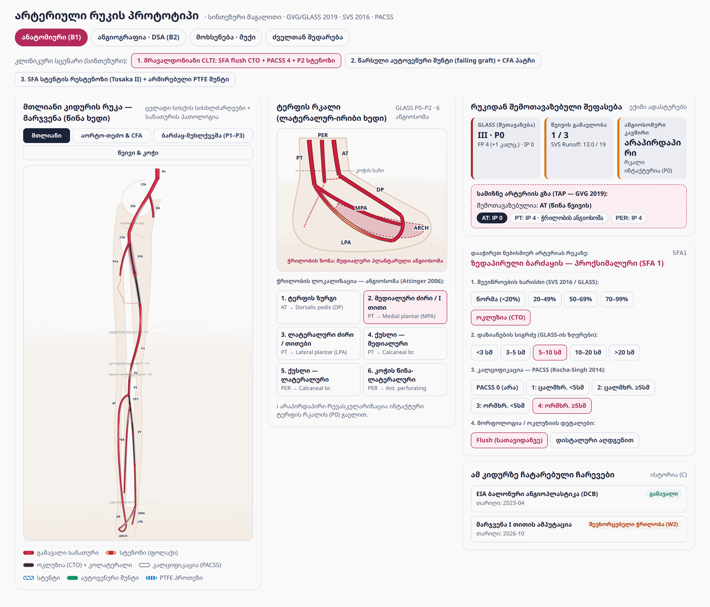
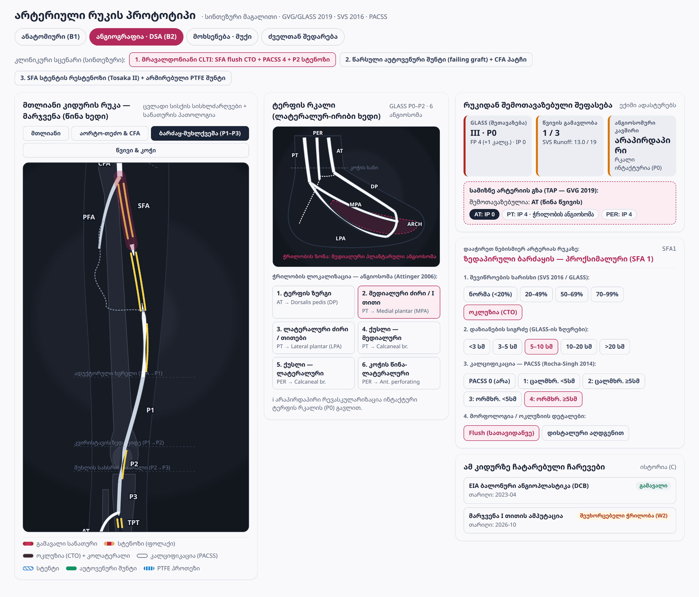
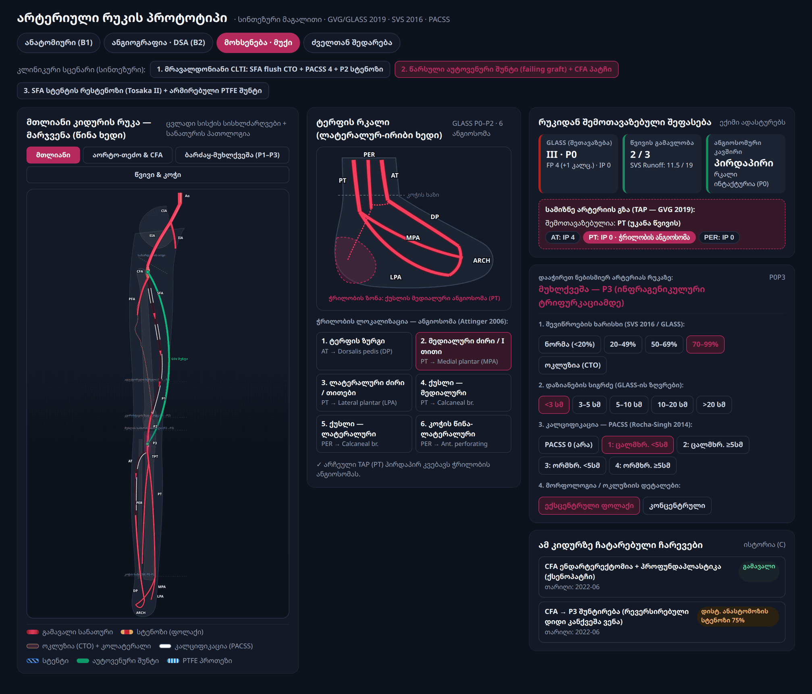
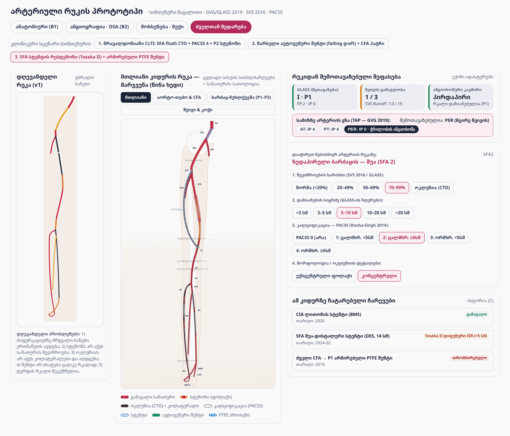
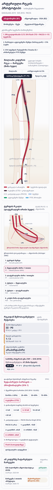

# აკადემიური არტერიული კარტირების, სისხლძარღვთა გრაფიკისა და წარსული ჩარევების განვითარების გეგმა (Plan)

> **სტატუსი:** სამუშაო გეგმა დასამტკიცებლად (კოდი, შაბლონები, მიგრაციები და ძირითადი ტოტი `claude/dazzling-cerf-tp4313` უცვლელია).  
> **ინტერაქტიული პროტოტიპი ამავე საქაღალდეში:** `docs/mapping-plan/prototype.html` (მხოლოდ სინთეზური მონაცემები, გარე ბიბლიოთეკების გარეშე).

---

## A. აკადემიური სტანდარტის არტერიული კარტირება (Academic-Standard Arterial Mapping)

### A.1 განხილული სტანდარტები, ზუსტი წყაროები და ციტირებული განმარტებები

ქვემოთ მოცემულია ყველა შეფასებული საერთაშორისო სტანდარტი ზუსტი ბიბლიოგრაფიითა და პირველწყაროდან მოყვანილი განმარტებებით. სადაც სტანდარტი კონკრეტულ ველს მკაცრად არ განსაზღვრავს და ეყრდნობა ზოგად ანგიოგრაფიულ პრაქტიკას, ეს ცალკეა აღნიშნული.

#### 1. Global Vascular Guidelines (GVG) — GLASS (ძირითადი სტადირებისა და სამიზნე გზის სტანდარტი — **რეკომენდებულია როგორც ბირთვი**)
- **წყარო:** Conte MS, Bradbury AW, Kolh P, White JV, Dick F, Fitridge R, Mills JL, Ricco JB, Suresh KR, Murad MH; GVG Writing Group (**SVS / ESVS / WFVS**). *Global vascular guidelines on the management of chronic limb-threatening ischemia.* **J Vasc Surg.** 2019 Jun;69(6S):3S–125S.e40 (ასევე *Eur J Vasc Endovasc Surg.* 2019;58(1S):S1–S109; [PMCID: PMC8365864](https://pmc.ncbi.nlm.nih.gov/articles/PMC8365864/), NIHMS-1728674 — უკვე გამოიყენება `apps/mdf/staging.py`-ში).
- **დამოწმებული განმარტებები და ცხრილები (Section 5: Anatomic Staging — GLASS):**
  - **სამიზნე არტერიის გზა (Target Arterial Path — TAP, Rec. 5.1):** *„the optimal arterial pathway to restore in-line (pulsatile) flow to the ankle and foot“* (ოპტიმალური არტერიული გზა კოჭსა და ტერფში უწყვეტი პულსაციური ნაკადის აღსადგენად).
  - **კიდურზე დაფუძნებული გამავლობა (Limb-Based Patency — LBP):** *„maintenance of in-line flow throughout the TAP, from groin to ankle“* (უწყვეტი ნაკადის შენარჩუნება მთელ TAP-ზე საზარდულიდან კოჭამდე).
  - **აორტო-თეძოს (Inflow — AI) დაავადების სტადირება (Table 5.2):**
    - **Type I:** *„Stenosis of the common and/or external iliac artery, chronic total occlusion of either common or external iliac artery (not both), stenosis of the infrarenal aorta; any combination of these.“*
    - **Type II:** *„Chronic total occlusion of the aorta; chronic total occlusion of common and external iliac arteries; severe diffuse disease and/or small-caliber (<6 mm) common and external iliac arteries; concomitant aneurysm disease; severe diffuse in-stent restenosis in the aortoiliac system.“*
    - **CFA მოდიფიკატორი:** `A` — საერთო ბარძაყის არტერიის მნიშვნელოვანი დაავადება არ არის (<50%); `B` — CFA-ს მნიშვნელოვანი სტენოზი (>50%). Inflow ფასდება ცალკე და GLASS გულისხმობს მის კორექციას (Table 5.1).
  - **ბარძაყ-მუხლქვეშა (Femoropopliteal — FP) ხარისხები 0–4 (Figure 5.2):**
    - **FP 0:** მსუბუქი ან არამნიშვნელოვანი (<50%) დაავადება.
    - **FP 1:** SFA-ს დაავადების ჯამური სიგრძე `<1/3 (<10 სმ)`; შეიძლება მოიცავდეს ერთ ფოკალურ CTO-ს (`<5 სმ`), თუ არ არის სათავის (flush) ოკლუზია; მუხლქვეშა არტერია — მსუბუქი ან არამნიშვნელოვანი დაავადება.
    - **FP 2:** SFA-ს დაავადება `1/3–2/3 (10–20 სმ)`; შეიძლება CTO ჯამში `<1/3 (10 სმ)`, არა-flush; მუხლქვეშა არტერიის ფოკალური სტენოზი `<2 სმ`, ტრიფურკაციის გარეშე.
    - **FP 3:** SFA-ს დაავადება `>2/3 (>20 სმ)`; შეიძლება ნებისმიერი flush ოკლუზია `<20 სმ` ან არა-flush CTO `10–20 სმ`; მუხლქვეშა არტერიის მოკლე სტენოზი `2–5 სმ`, ტრიფურკაციის გარეშე.
    - **FP 4:** SFA-ს ოკლუზია `>20 სმ`; მუხლქვეშა არტერიის დაავადება `>5 სმ` ან ტრიფურკაციაზე გავრცელებით (*„termination of the popliteal artery at the confluence of the anterior tibial (AT) artery and tibioperoneal trunk“*); მუხლქვეშა არტერიის ნებისმიერი CTO.
  - **ინფრაპოპლიტეალური (Infrapopliteal — IP) ხარისხები 0–4 TAP-ის გასწვრივ (Figure 5.3):**
    - **IP 0:** მსუბუქი ან არამნიშვნელოვანი (<50%) დაავადება სამიზნე არტერიის გზაზე.
    - **IP 1:** წვივის არტერიის ფოკალური სტენოზი `<3 სმ` (TP ღეროს გარეშე).
    - **IP 2:** სტენოზი არტერიის სიგრძის `<1/3`-ზე (`<10 სმ`); შეიძლება ერთი ფოკალური CTO (`<3 სმ`), რომელიც არ მოიცავს TP ღეროს ან სამიზნე არტერიის სათავეს (origin).
    - **IP 3:** დაავადება არტერიის სიგრძის `1/3–2/3`-მდე (`10–20 სმ`); CTO `1/3`-მდე (`3–10 სმ`; შეიძლება მოიცავდეს სამიზნე არტერიის სათავეს, მაგრამ არა TP ღეროს).
    - **IP 4:** დიფუზური სტენოზი `>2/3` (`>20 სმ`); CTO `>1/3` (`>10 სმ`, შეიძლება სათავის ჩათვლით); TP ღეროს ნებისმიერი CTO, თუ სამიზნე არტერია არ არის AT.
  - **მძიმე კალციფიკაციის დიქოტომიური მოდიფიკატორი (Figures 5.2–5.3):** `>50%` გარშემოწერილობის, დიფუზური, მასიური (bulky) ან „მარჯნისებრი“ (*„coral reef“*) კალციფიკაცია FP ან IP სეგმენტში ზრდის შესაბამის ხარისხს `+1`-ით (მაქს. 4).
  - **ინფრამალეოლური / ტერფის აღმწერი (Inframalleolar / Pedal Descriptor — Figure 5.1):**
    - **P0:** *„Target artery crosses ankle into foot, with intact pedal arch“* (სამიზნე არტერია კვეთს კოჭს და გადადის ტერფში; ტერფის რკალი ინტაქტურია).
    - **P1:** *„Target artery crosses ankle into foot; absent or severely diseased pedal arch“* (სამიზნე არტერია კვეთს კოჭს; ტერფის რკალი არ არის ან მძიმედ დაზიანებულია).
    - **P2:** *„No target artery crossing ankle into foot“* (კოჭს არცერთი სამიზნე არტერია არ კვეთს).

#### 2. SVS Reporting Standards (2016) და SVS/ISCVS Runoff Score (1997 / 2016) — **რეკომენდებულია სეგმენტური აღწერისა და გამავლობის ქულისთვის**
- **წყაროები:**
  1. Stoner MC, Calligaro KD, Chaer RA, Dietzek AM, Farber A, Guzman RJ, Hamdan AD, Schermerhorn ML, Zierler RE; **Society for Vascular Surgery**. *Reporting standards of the Society for Vascular Surgery for endovascular treatment of chronic lower extremity peripheral artery disease.* **J Vasc Surg.** 2016 Jul;64(1):e1–e21 ([PMID: 27345516](https://pubmed.ncbi.nlm.nih.gov/27345516/); მოკლე ვერსია: *J Vasc Surg.* 2016;64(1):227–228).
  2. Rutherford RB, Baker JD, Ernst C, Johnston KW, Porter JM, Ahn S, Jones DN. *Recommended standards for reports dealing with lower extremity ischemia: Revised version.* **J Vasc Surg.** 1997 Sep;26(3):517–538 (PMID: 9308598).
- **დამოწმებული მოთხოვნები და განმარტებები (Stoner et al., 2016):**
  - **სეგმენტისა და დაზიანების სავალდებულო აღწერა:** *„Lesion length, occlusion, or degree of stenosis should be noted and reported. Reporting of superficial femoral artery (SFA) disease should also note a flush occlusion if present, the relation to the ostium of the SFA, and the relation to the adductor hiatus. Popliteal disease location should be reported in the P1 (suprageniculate), P2 (retrogeniculate), or P3 (infrageniculate) segment.“*
  - **დამატებითი ანგიოგრაფიული მახასიათებლები:** თრომბოზი (*„nonocclusive or occlusive thrombus“*), ფოლაქის დაწყლულება (*plaque ulceration*), დაკლაკნილობა (*mild `<30°`*, *moderate `30°–60°`*, *severe hairpin `>60°`*) და კოჭქვეშ გამავალი არტერიების რაოდენობა (*number of outflow vessels: 0–3*). რესტენოზის ზღვარი ჩარევის შემდეგ: `≥50%` დიამეტრის სტენოზი ან დუპლექსით `PSVR ≥ 2.8`.
  - *(შენიშვნა გამჭვირვალობისთვის: ფოლაქის ექსცენტრულობა — `eccentric` vs `concentric` — არის ზოგადი ანგიოგრაფიული/AHA მორფოლოგიური ტერმინი და არ შედის SVS 2016-ის ქულობრივ ცხრილში; ვტოვებთ არჩევით მორფოლოგიურ მონიშვნად).*
  - **Modified SVS Runoff Score (Stoner et al., 2016 — პირდაპირი ციტატა):**
    > *„A score of 0 is assigned to a vessel with <20% stenosis, a score of 1 for a 21% to 49% stenosis, 2 for 50% to 99% stenosis, 2.5 for a vessel occluded over an area less than half its length, and 3 for an occlusion greater than half the vessel length. The score for the popliteal artery is multiplied by 3 and a value of 1 is added before adding all 4 vessel scores together, giving a range of possible popliteal artery scores from 1 to 10.“*
    - ჯამური ქულა (მუხლქვეშა + 3 წვივის არტერია): `(Popliteal × 3 + 1) + AT + PT + Peroneal`. არითმეტიკული დიაპაზონია **1.0–19.0** (რაც მაღალია ქულა, მით უარესია დისტალური წინაღობა; *შენიშვნა: Stoner 2016-ის ტექსტში წერია „0 to 19“, თუმცა `+1`-ის დამატების გამო მინიმალური არითმეტიკული მნიშვნელობაა `1.0`*).
  - **SVS Pedal / Foot Runoff Score (Rutherford 1997 / Stoner 2016):** `Dorsalis Pedis + Medial Plantar + Lateral Plantar + 1` (თითოეული ფასდება იმავე `0 / 1 / 2 / 2.5 / 3` შკალით → ჯამური ქულა **1.0–10.0**; `<7` კარგი გამავლობა, `≥7` ცუდი გამავლობა).

#### 3. PACSS — Peripheral Arterial Calcium Scoring System (**რეკომენდებულია კალციფიკაციის შესაფასებლად**)
- **წყარო:** Rocha-Singh KJ, Zeller T, Jaff MR. *Peripheral arterial calcification: Prevalence, mechanism, detection, and clinical implications.* **Catheter Cardiovasc Interv.** 2014 May 1;83(6):E212–E220 ([PMCID: PMC4262070](https://pmc.ncbi.nlm.nih.gov/articles/PMC4262070/), PMID: 24402839, **Table 1**).
- **Table 1 — პირდაპირი ციტირება (AP ფლუოროსკოპია / DSA სამიზნე დაზიანების უბანზე):**
  - **Grade 0:** *„No visible calcium at the target lesion site“* (ხილული კალციუმი არ არის)
  - **Grade 1:** *„unilateral calcification < 5cm“* (ცალმხრივი კედლის კალციფიკაცია <5 სმ)
  - **Grade 2:** *„unilateral calcification ≥ 5cm“* (ცალმხრივი კედლის კალციფიკაცია ≥5 სმ)
  - **Grade 3:** *„bilateral calcification < 5cm“* (ორმხრივი კედლის კალციფიკაცია <5 სმ)
  - **Grade 4:** *„bilateral calcification ≥ 5cm“* (ორმხრივი კედლის კალციფიკაცია ≥5 სმ)
  - *(ორიგინალ Table 1-ში არსებული ქვეტიპები `a) intimal, b) medial, c) mixed` ანგიოგრაფიაზე იშვიათად გაირჩევა IVUS-ის გარეშე, ამიტომ კლინიკურ კვლევებში გამოიყენება 0–4 ხარისხი; PACSS **Grade 3–4** ვალიდირებულ კოჰორტებში [მაგ., PMC11541408] შეესაბამება „მძიმე კალციფიკაციას“ და გამოიყენება GLASS-ის `+1` მოდიფიკატორის შესათავაზებლად).*

#### 4. TASC II (შეფასებულია მხოლოდ შესადარებლად — **არ არის რეკომენდებული როგორც ძირითადი სისტემა**)
- **წყაროები:** Norgren L, Hiatt WR, Dormandy JA, et al.; **TASC II Working Group**. *J Vasc Surg.* 2007 Jan;45(Suppl S):S5–S67; წვივის განახლება: Jaff MR, White CJ, Hiatt WR, et al. *J Endovasc Ther.* 2015 Oct;22(5):663–677.
- **რატომ არ ვირჩევთ ძირითად სისტემად:** როგორც GVG 2019 (Section 5) განმარტავს, TASC II აფასებს ცალკეულ ანატომიურ სეგმენტს იზოლირებულად (`Type A–D`) და არა მთლიან კიდურსა და უწყვეტ სამიზნე გზას (`TAP`), რაც კრიტიკული იშემიის მრავალდონიანი (FP + IP + ტერფი) დაზიანებისას არასაკმარისია. ამასთან, TASC-ის ძველი დიქოტომია („A/B = ენდო, C/D = ღია“) აღარ ითვალისწინებს პაციენტის რისკსა და WIfI სტადიას (რასაც PLAN აკეთებს). სურვილის შემთხვევაში, TASC A–D შეიძლება გამოჩნდეს მხოლოდ საინფორმაციო მინიშნებად იზოლირებული აორტო-თეძოს (მაგ. კლაუდიკაციის / ლერიშის) შემთხვევებში.

#### 5. დამატებითი მიზნობრივი კლასიფიკაციები (რეკომენდებულია სრულყოფილი კარტირებისთვის)
- **ტერფისა და კოჭის 6 ანგიოსომა (Wound Angiosomes):** Taylor GI, Palmer JH (*Br J Plast Surg.* 1987;40:113–141) და Attinger CE, Evans KK, Bulan E, Blume P, Cooper P. *Angiosomes of the foot and ankle and clinical implications for limb salvage: reconstruction, incisions, and revascularization.* **Plast Reconstr Surg.** 2006 Jun;117(7 Suppl):261S–293S ([PMID: 16799395](https://pubmed.ncbi.nlm.nih.gov/16799395/)):
  1. **AT → Dorsalis pedis (DP):** ტერფის ზურგი და თითების დორსალური ზედაპირი (`dorsal`);
  2. **PT → Medial plantar (MPA):** ტერფის თაღი / მედიალური ძირი და I თითი (`medial_plantar`);
  3. **PT → Lateral plantar (LPA):** ლატერალური შუა/წინა ტერფის ძირი და ლატერალური თითები (`lateral_plantar`);
  4. **PT → Medial calcaneal branch:** ქუსლის მედიალური და ძირის ნაწილი (`medial_heel`);
  5. **Peroneal → Lateral calcaneal branch:** ქუსლის ლატერალური ნაწილი (`lateral_heel`);
  6. **Peroneal → Anterior perforating branch:** კოჭის წინა-ლატერალური მიდამო (`lateral_ankle`).
- **სტენტის შიდა რესტენოზი (Femoropopliteal ISR — Tosaka Classification):** Tosaka A, Soga Y, Iida O, et al. *Classification and clinical impact of restenosis after femoropopliteal stenting.* **J Am Coll Cardiol.** 2012 Jan 3;59(1):16–23 ([PMID: 22192663](https://pubmed.ncbi.nlm.nih.gov/22192663/)):
  - **Class I (focal ISR):** ფოკალური რესტენოზი `≤50 მმ` (`≤5 სმ`) სტენტის სხეულში ან კიდეზე;
  - **Class II (diffuse ISR):** დიფუზური რესტენოზი `>50 მმ` (`>5 სმ`);
  - **Class III (occlusive ISR):** სტენტის სრული ოკლუზია (`100%`).
- **საერთო ბარძაყის არტერიის ბიფურკაცია (Azéma Classification — არჩევითი CFA-სთვის):** Azéma L, Davaine JM, Guyomarch B, et al. *Eur J Vasc Endovasc Surg.* 2011 Jun;41(6):797–803 ([PMID: 21439857](https://pubmed.ncbi.nlm.nih.gov/21439857/)): Type I (EIA→CFA), Type II (იზოლირებული CFA), Type III (CFA + ბიფურკაცია SFA/PFA სათავეებით), Type IV (შუნტის ანასტომოზის სტენოზი).

---

### A.2 რა აღირიცხება თითოეულ სეგმენტზე და მთლიან კიდურზე

#### სეგმენტების სიის დაზუსტება (22-დან 26 სეგმენტამდე, სრული თავსებადობით):
დღევანდელ 22 სეგმენტს ემატება 4 ანატომიურად აუცილებელი ერთეული (SVS 2016 და GVG 2019 მოთხოვნების დასაკმაყოფილებლად):
1. `aorta` — ინფრარენული აორტა (GLASS AI Type I/II განსასაზღვრად);
2. `iia` — შიგნითა თეძოს არტერია (მენჯის კოლატერალები / დუნდულოს კლაუდიკაცია);
3. `pop2` (`P2–3`) იყოფა **`pop2` (`P2` — რეტროგენიკულური, მუხლის სახსრის ხაზი — „no-stent zone“)** და **`pop3` (`P3` — ინფრაგენიკულური ტრიფურკაციამდე)** სეგმენტებად (SVS 2016);
4. `plantar` იყოფა **`mpa` (მედიალური პლანტარული)** და **`lpa` (ლატერალური პლანტარული)** არტერიებად (`dp`-სა და `arch`-ის გვერდით — SVS ტერფის ქულისა და 6 ანგიოსომისთვის).

| დონე | ველი | შესაძლო მნიშვნელობები | წყარო / დანიშნულება |
|---|---|---|---|
| **სეგმენტი** | `stenosis` | `'none'` (`<20%`), `'mild'` (`20–49%`), `'moderate'` (`50–69%`), `'severe'` (`70–99%`), `'occlusion'` (`100%`) | SVS 2016 (0/1/2/2.5–3) + GLASS (`≥50%` ზღვარი) |
| **სეგმენტი** | `length_cm` | რიცხვი (`0.5–40 სმ`) ან სწრაფი ღილაკები (`<3`, `3–5`, `5–10`, `10–20`, `>20 სმ`) | GLASS Figs 5.2–5.3 (`2, 3, 5, 10, 20 სმ` ზღვრები) |
| **სეგმენტი (CTO)** | `flush` | `true / false` — სათავიდანვე (ostial/flush) ოკლუზია ტაკვის გარეშე | GLASS Fig 5.2 (SFA), Fig 5.3 (tibial origin), SVS 2016 |
| **სეგმენტი (CTO)** | `reconstitution` | `'yes'` (აღდგება კოლატერალებით), `'delayed'`, `'none'` | შუნტის დისტალური ანასტომოზის ადგილის შერჩევა |
| **სეგმენტი** | `calc` | `0, 1, 2, 3, 4` (PACSS) + არჩევითი `coral: true` („მარჯნისებრი“) | Rocha-Singh 2014 (Table 1) + GLASS `+1` |
| **სეგმენტი** | `morph` | `''`, `'eccentric'`, `'concentric'` | ფოლაქის ფორმა (არჩევითი) |
| **სეგმენტი** | `thrombus`, `aneurysm`, `ulcerated`, `small_caliber`, `trifurcation` | ბულური ალმები (მხოლოდ არსებობისას) | SVS 2016 + GLASS Table 5.2 (`<6 მმ`, ანევრიზმა) + Fig 5.2 (ტრიფურკაცია) |
| **კიდური** | `ai`, `cfa` | `AI`: `'' / 'I' / 'II'`; `CFA`: `'A' / 'B'` (+ არჩევითი Azéma `I–IV`) | GLASS Table 5.2 |
| **კიდური** | `tap` | `'at' / 'pt' / 'per'` (რუკიდან შეთავაზებით + ექიმის დასტურით) | GLASS Section 5 |
| **კიდური** | `pedal` | `'P0' / 'P1' / 'P2'` | GLASS Fig 5.1 |
| **კიდური** | `wound_angiosome` | `'none'`, `'dorsal'`, `'medial_plantar'`, `'lateral_plantar'`, `'medial_heel'`, `'lateral_heel'`, `'lateral_ankle'` | Attinger 2006 (პირდაპირი vs არაპირდაპირი რევასკულარიზაცია) |
| **კიდური** | `runoff` (გამოთვლითი) | გამავალი წვივის არტერიები (`0–3`), Modified SVS Runoff (`1–19`), Foot Score (`1–10`) | Rutherford 1997 / Stoner 2016 |
| **კიდური** | `interventions` | წარსული ჩარევების სტრუქტურირებული სია (იხ. ნაწილი C) | SVS 2016 / Tosaka 2012 |

---

### A.3 GLASS-ისა და TAP-ის ავტომატური შეთავაზების წესები (`suggest_from_map`)

> **ოქროს წესი:** რუკიდან გამოთვლილი ყველა მაჩვენებელი არის **მხოლოდ შეთავაზება (decision support)**. ის არასდროს გადააწერს ექიმის მიერ ხელით მონიშნულ ხარისხს დაუკითხავად — ეკრანზე ჩნდება მინიშნება *„რუკიდან შემოთავაზებულია: FP 3, IP 1 (AT), P0 — დადასტურება“*.

1. **Inflow (`AI` და `CFA`) შეთავაზება (GVG Table 5.2):**
   - `CFA = 'B'`, თუ `cfa`-ზე მონიშნულია `stenosis ≥ 50%` (`moderate`, `severe`, `occlusion`), სხვაგვარად `'A'`.
   - `AI = 'II'`, თუ `aorta` არის `'occlusion'`, ან (`cia` და `eia` ორივე `'occlusion'`), ან `aorta/cia/eia`-ზე მონიშნულია `aneurysm`, `small_caliber` (`<6 მმ`) ან სტენტის დიფუზური/ოკლუზიური რესტენოზი (Tosaka II–III).
   - `AI = 'I'`, თუ ზემოთ ჩამოთვლილი არ სრულდება, მაგრამ `aorta`, `cia` ან `eia`-დან რომელიმეზე არის `stenosis ≥ 50%` (მათ შორის მხოლოდ `cia`-ს ან მხოლოდ `eia`-ს იზოლირებული CTO).
2. **GLASS `FP` ხარისხის (0–4) და `fp_calc` (+1) შეთავაზება (GVG Fig 5.2):**
   - ჯამდება მნიშვნელოვანი დაზიანების (`≥50%`) სიგრძე $L_{\text{SFA}}$ და ოკლუზიის სიგრძე $L_{\text{SFA,CTO}}$ `sfa1..3`-ზე (თუ ექიმს სეგმენტზე `length_cm` არ მიუთითებია, თითო მესამედი შეფასდება `~9 სმ`-ად და მიეწერება *„სავარაუდო სიგრძით — დააზუსტეთ სმ“*) და მუხლქვეშა დაზიანება `pop1..3`-ზე ($L_{\text{POP}}$):
     - **FP 4:** ნებისმიერი `pop1..3`-ის CTO, ან $L_{\text{POP}} > 5\text{ სმ}$, ან `trifurcation = true`, ან $L_{\text{SFA,CTO}} > 20\text{ სმ}$.
     - **FP 3:** $L_{\text{SFA}} > 20\text{ სმ}$, ან (`sfa1` CTO + `flush = true` და $L_{\text{SFA,CTO}} \le 20\text{ სმ}$), ან არა-flush $10 \le L_{\text{SFA,CTO}} \le 20\text{ სმ}$, ან მუხლქვეშა სტენოზი $2 \le L_{\text{POP}} \le 5\text{ სმ}$ (ტრიფურკაციის გარეშე).
     - **FP 2:** $10 \le L_{\text{SFA}} \le 20\text{ სმ}$, ან არა-flush $5 \le L_{\text{SFA,CTO}} < 10\text{ სმ}$, ან მუხლქვეშა ფოკალური სტენოზი $0 < L_{\text{POP}} < 2\text{ სმ}$.
     - **FP 1:** $0 < L_{\text{SFA}} < 10\text{ სმ}$ (შეიძლება ერთი არა-flush CTO $<5\text{ სმ}$) და მუხლქვეშა არტერიაზე `<50%` დაზიანება.
     - **FP 0:** SFA-სა და მუხლქვეშა არტერიაში `≥50%` დაზიანება არ არის.
   - **`fp_calc` (+1):** შეთავაზებულია, თუ `sfa1..3` ან `pop1..3`-დან რომელიმეს აქვს `PACSS ≥ 3` (ორმხრივი კალციფიკაცია) ან `coral = true`.
3. **GLASS `IP` ხარისხის (0–4) გამოთვლა სამივე წვივის გზისთვის (`AT`, `PT`, `PER`) ცალ-ცალკე (GVG Fig 5.3):**
   - `AT` გზა = `at1..3`; `PT` გზა = `tpt + pt1..3`; `PER` გზა = `tpt + per1..3` (წვივის არტერიის სტანდარტული სიგრძე ~30 სმ: `1/3 ≈ 10 სმ`, `2/3 ≈ 20 სმ`):
     - **IP 4:** ჯამური `≥50%` დაზიანება `>20 სმ` (`>2/3`), ან CTO `>10 სმ` (`>1/3`), ან (`PT`/`PER` გზისთვის) `tpt`-ს ნებისმიერი CTO.
     - **IP 3:** ჯამური დაზიანება `10–20 სმ` (`1/3–2/3`), ან CTO `3–10 სმ` (`≤1/3`), ან სათავის (`flush = true` `at1/pt1/per1`-ზე) ფოკალური CTO `<3 სმ` (`tpt`-ს CTO-ს გარეშე).
     - **IP 2:** სტენოზი `3–10 სმ` (`<1/3`), ან ფოკალური CTO `<3 სმ` სათავისა და `tpt`-ს ჩართვის გარეშე, ან `tpt`-ს სტენოზი (`PT`/`PER`-ისთვის).
     - **IP 1:** წვივის არტერიის ერთი ფოკალური სტენოზი `<3 სმ` (`tpt`-ს დაზიანების გარეშე).
     - **IP 0:** `<50%` დაზიანება სამიზნე გზაზე.
   - **`ip_calc` (+1):** შეთავაზებულია, თუ არჩეული TAP-ის სეგმენტებზე არის `PACSS ≥ 3` ან `coral = true`.
4. **TAP-ისა და ტერფის `P0–P2`-ის შეთავაზება (GVG Section 5, Fig 5.1 & Attinger 2006):**
   - ინტერფეისი ერთდროულად აჩვენებს სამივე გზის სირთულეს (მაგ., `AT: IP 1 · PT: IP 4 (ჭრილობის ანგიოსომა) · PER: IP 2`) და სთავაზობს გზას უმცირესი `IP` ხარისხით კოჭზე გამავალ არტერიებს შორის; თანაბარი სირთულისას უპირატესობას ანიჭებს `wound_angiosome`-ის პირდაპირ მკვებავ არტერიას (`AT` და `PT` პრიორიტეტულია `PER`-თან შედარებით).
   - **Pedal `P0–P2`:** თუ არც `dp` და არც `mpa/lpa` არ იღებს გამავალ ნაკადს კოჭის გავლით → `P2`; თუ კვეთს კოჭს და `arch` გამავალია (`<50%`) → `P0`; თუ კვეთს კოჭს, მაგრამ `arch` დაზიანებულია (`≥50%` / CTO) → `P1`.

---

### A.4 მონაცემთა მოდელი: ვერსიირებული JSON სქემა (`v: 2`) და არსებული მონაცემების უდანაკარგო მიგრაცია

`Case.staging` უკვე არის `JSONField` (`0038_case_staging`), ამიტომ **ახალი საბაზო მიგრაცია საჭირო არ არის**. `Case.staging[side]` იღებს ვერსიის ნიშანს `"v": 2`:

```json
{
  "v": 2,
  "segments": {
    "eia":  { "stenosis": "mild", "length_cm": 3.0, "calc": 1, "morph": "eccentric" },
    "sfa1": { "stenosis": "occlusion", "length_cm": 8.0, "calc": 4, "flush": true, "reconstitution": "none" },
    "sfa2": { "stenosis": "occlusion", "length_cm": 9.0, "calc": 4, "reconstitution": "yes" },
    "pop2": { "stenosis": "severe", "length_cm": 3.0, "calc": 2, "morph": "concentric" },
    "tpt":  { "stenosis": "occlusion", "length_cm": 3.0, "calc": 3, "reconstitution": "none" }
  },
  "interventions": [
    {
      "id": "iv1",
      "type": "bypass",
      "conduit_group": "vein",
      "conduit": "gsv_reversed",
      "cuff": "",
      "proximal": "cfa",
      "distal": "pop3",
      "performed_on": "2022-06",
      "status": "stenosed",
      "site": "distal",
      "note": "დისტალური ანასტომოზის 75% სტენოზი"
    },
    {
      "id": "iv2",
      "type": "endarterectomy",
      "subtype": "patch_bovine",
      "segments": ["cfa", "pfa"],
      "performed_on": "2022-06",
      "status": "patent",
      "note": ""
    }
  ],
  "wound_angiosome": "medial_plantar",
  "tap": "at",
  "fp": 3, "fp_calc": true,
  "ip": 0, "ip_calc": false,
  "pedal": "P0",
  "ai": "", "cfa": "A",
  "w": 2, "i": null, "fi": 1, "unsalvageable": false,
  "abi": null, "ap": null, "tp": null,
  "risk": "avg", "vein": "yes",
  "note": ""
}
```

#### როგორ იკითხება და გარდაიქმნება დღევანდელი (`v1`) ჩანაწერები (`staging.upgrade_limb`):
თუ ჩანაწერს არ აქვს `"v": 2`, `upgrade_limb()` წაკითხვისთანავე გარდაქმნის მას მეხსიერებაში (და შენახვისას ჩაწერს `v: 2`-ად, ძველი ჩანაწერების დაუზიანებლად):
1. `s: 'mild'` → `stenosis: 'mild'` (`20–49%`); `s: 'st'` → `stenosis: 'severe'` (`≥50%`); `s: 'oc'` → `stenosis: 'occlusion'`.
2. `ca: true` → `calc: 3` (მძიმე კალციფიკაცია, PACSS ≥3 ექვივალენტი).
3. ძველი სეგმენტი `'pop2'` (`P2–3`) გადადის `'pop2'`-ში, ხოლო `'plantar'` (რომელსაც კოდში უკვე ერქვა *„ტერფის ლატერალური ძირის“*) — `'lpa'`-ში.
4. ძველი ალამი **`rx: true`** (მომიჯნავე სეგმენტებზე, მაგ. `['sfa2', 'sfa3']`) ავტომატურად იქცევა ერთ ჩანაწერად `interventions`-ში: `type: 'stent'`, `subtype: 'unspecified'` (*„სტენტი / ანგიოპლასტიკა — დაუზუსტებელი“*), ხოლო `status` განისაზღვრება ამავე სეგმენტის `s`-ით (`'oc'` → `'occluded'`, `'st'` → `'isr_1'`, სხვა → `'patent'`).
5. ძველი ალამი **`by: true`** გარდაიქმნება ჩანაწერად `type: 'bypass'`, `conduit_group: 'unspecified'`, სადაც `proximal` არის მონიშნული ჯაჭვის ყველაზე ზედა სეგმენტი, ხოლო `distal` — ყველაზე ქვედა.
6. **ცვლილებები `staging.clean()`-სა და `staging.compute()`-ში:**
   - `clean()` ატარებს `upgrade_limb()`-ს, ამოწმებს `segments`-ის ყველა ველს ცნობილ სიებთან/დიაპაზონებთან (უცნობ გასაღებებს და ნორმალურ სეგმენტებს აშორებს), ამოწმებს `interventions` სიას (მაქს. 20 ჩანაწერი თითო კიდურზე, თარიღის ფორმატი `YYYY` / `YYYY-MM` / `YYYY-MM-DD`).
   - `compute()` **უცვლელად ინარჩუნებს არსებულ GLASS / WIfI / PLAN ცხრილებსა და შედეგებს** (`StagingTablesTests` 100%-ით მწვანე რჩება) და დამატებით აბრუნებს `suggested` ლექსიკონს (`fp`, `fp_calc`, `ip_by_tap`, `tap`, `pedal`, `ai`, `cfa`, `runoff_count`, `svs_runoff`, `foot_runoff`, `angiosome_direct`).

---

## B. გაუმჯობესებული სისხლძარღვთა გრაფიკა (Much Better Vessel Graphics)

### B.1 ოთხი ვარიანტის შედარებითი შეფასება

| კრიტერიუმი | **B1: ცვლადი სისქის მილაკოვანი SVG + სანათურის პათოლოგია (ვექტორულ ძვლოვან-კუნთოვან ფონზე)** | **B2: ანგიოგრაფიის (DSA Roadmap) გადამრთველი** *(B1-ის დამატება)* | **B3: დამატებითი ხედები — ტერფის ირიბი რკალი + აორტო-თეძო + ზონური Zoom** *(B1-ის დამატება)* | **B4: ახალი AI სურათი ან ნაყიდი სამედიცინო ილუსტრაცია** |
|---|---|---|---|---|
| **ვიზუალური დონე** | ქირურგიული ატლასის დონე: გლუვი Y-ბიფურკაციები ხაზების გადაკვეთის გარეშე, მოცულობითი ჩრდილი, რეალური შევიწროება (ექსცენტრული/კონცენტრული ფოლაქი), CTO ტაკვით, კოლატერალებითა და აღდგენით, ორმხრივი კალციფიკაცია, სტენტის ბადე, ცალკე რკალად გაყვანილი შუნტი ანასტომოზებით | კათეტერიზაციის ლაბორატორიის DSA ეკრანი: მუქი ფონი, მკრთალი ძვლოვანი ორიენტირები, კონტრასტული თეთრი სანათური, „string sign“ სტენოზზე და კონტრასტის წყვეტა CTO-ზე | ხსნის მთავარ ანატომიურ პრობლემას: წინა ხედში დამოკლებული ტერფის ნაცვლად ჩანს DP, MPA, LPA, ღრმა რკალი და 6 ანგიოსომა; მკაფიოდ ჩანს P1/P2/P3 საზღვრები | სტატიკური ფონი უკეთესი კუნთებით, მაგრამ დაავადება მაინც ზემოდან დადებულ ხაზებად რჩება |
| **შესაბამისობა დაკლიკვად სეგმენტებთან** | **იდეალური (100%):** ძვლოვანი ორიენტირები და არტერიები ერთსა და იმავე SVG კოორდინატებშია — არასდროს აცდება | იგივე გეომეტრია (0 აცდენა) | იგივე მონაცემები სინქრონულად აისახება მთავარ რუკასა და ტერფის ჩანართზე | **მაღალი რისკი:** სურათის ყოველი შეცვლისას კოორდინატები ხელით თავიდანაა დასასმელი |
| **ღია / მუქი / პროექტორი / 390px / ბეჭდვა** | უსასრულო გარჩევადობა 4K პროექტორზეც და A4 შავ-თეთრ ბეჭდვაზეც | საუკეთესოა ბნელ საკონფერენციო დარბაზში პროექტორზე | 4-ზონიანი Zoom ღილაკი 390px ტელეფონზე გამორიცხავს წვრილ არტერიაზე აცდენას | მუქ რეჟიმსა და შავ-თეთრ ბეჭდვაზე რასტრული სურათი კარგავს კონტრასტს |
| **ფაილის ზომა და სისწრაფე** | `~20–30 KB` (უფრო მსუბუქიც კია, ვიდრე 45 KB WebP), მყისიერი ჩატვირთვა | `+2 KB` CSS (ნულოვანი დატვირთვა) | `+8 KB` SVG/JS | `150–400 KB` თითო ხედზე |
| **რისკები და ლიცენზია** | საჭიროებს ზუსტ ანატომიურ კონტროლს აგებისას | არ აქვს (იყენებს B1-ის კონტურებს) | ეკრანის გადატვირთვის თავიდან ასაცილებლად ტერფის ჩანართი კომპაქტური უნდა იყოს | **კრიტიკული რისკი:** ფასიანი სამედიცინო ილუსტრაციების ლიცენზია კრძალავს საჯარო GitHub რეპოზიტორიაში განთავსებას; AI კი ხშირად ამახინჯებს წვივის/ტერფის ანატომიას |
| **ახალი ბიბლიოთეკა** | **არ სჭირდება** | **არ სჭირდება** | **არ სჭირდება** | არ სჭირდება |
| **შრომატევადობა** | საშუალო–მაღალი (~1.5–2 დღე) | დაბალი (~0.5 დღე B1-ის შემდეგ) | საშუალო (~1 დღე) | საშუალო (მაგრამ შედეგი შეზღუდულია) |

### B.2 რეკომენდაცია და პროტოტიპის ვიზუალები

**რეკომენდაცია:** განვახორციელოთ **B1 + B2 + B3 ერთიან ვექტორულ სისტემად** (ახალი ბიბლიოთეკების გარეშე):
1. **სამშრიანი (3-layer) ცვლადი სისქის სისხლძარღვთა ხატვა (B1):** ჯერ იხატება ყველა არტერიის გარეთა კედელი (ადვენტიცია) ერთიანად — რის გამოც ყველა ბიფურკაცია (`CFA → SFA/PFA`, `P3 → AT/TPT`, `TPT → PT/PER`) ბუნებრივად და გლუვად ერთდება; შემდეგ იხატება ფოლაქი/თრომბი; ბოლოს — სისხლის სანათური, რომელიც სტენოზის ადგილას რეალურად ვიწროვდება (კონცენტრულად ან ექსცენტრულად), ხოლო CTO-ზე წყდება (ტაკვით ან flush-ად), გარს უვლის დაკლაკნილი კოლატერალები და დისტალურად აღდგება. ღრმა/უკანა მდებარეობის სეგმენტები (`P1–P3`, `TPT`, `PT`, `PER`) გამოყოფილია ნახევრადგამჭვირვალე ძვლოვანი ორიენტირების ფონზე.
2. **ერთი დაჭერით გადართვა `ანატომიური` ↔ `ანგიოგრაფია (DSA)` (B2):** განსაკუთრებით ეფექტურია კონფერენციაზე ნამდვილი ანგიოგრამის გვერდით განხილვისას.
3. **ლატერალურ-ირიბი ტერფის ჩანართი (`Pedal Loop View`) + 4-ზონიანი გადიდება ტელეფონისთვის (B3):** ცალკე მკაფიოდ აჩვენებს `AT → DP`, `PT → MPA / LPA`, `PER` ტოტებს, ღრმა პლანტარულ რკალსა და ჭრილობის 6 ანგიოსომას (უკანა მუხლის ცალკე ხედი აღარ არის საჭირო, რადგან ძვლოვანი ორიენტირებით `P1 / P2 / P3` საზღვრები და `बარძაყ-მუხლქვეშა` Zoom პირდაპირ მთავარ რუკაზევე იკითხება ზედმეტი დუბლირების გარეშე).

#### პროტოტიპის ანაბეჭდები (`docs/mapping-plan/prototype.html`-დან):











---

## C. წარსული ჩარევების ცალკე აღრიცხვა და ვიზუალიზაცია (Prior Interventions)

ძველი ორი ალმის (`rx` და `by`) ნაცვლად, თითოეულ კიდურს ექნება ქრონოლოგიური სია `interventions`, სადაც თითოეული ჩარევა იხატება თავისი უნიკალური გრაფიკული ენით:

1. **შუნტირება (`type: 'bypass'`):**
   - **კონდუიტი (`conduit_group` + `conduit`):**
     - *აუტოვენა (`vein`):* დიდი კანქვეშა რევერსირებული (`gsv_reversed`), დიდი კანქვეშა *in situ* (`gsv_insitu`), არარევერსირებული/ტრანსლოცირებული (`gsv_nonrev`), მცირე კანქვეშა (`ssv`), ზედა კიდურის ვენა (`arm_vein`), შედგენილი/სპლაისირებული (`spliced`);
     - *სინთეზური პროთეზი (`prosthetic`):* PTFE (`ptfe`), არმირებული PTFE (`ptfe_ringed`), ჰეპარინით დაფარული PTFE (`ptfe_heparin`), დაკრონი (`dacron`); + არჩევითი დისტალური **ვენური მანჟეტი** (`cuff: 'miller'` — Miller cuff / Taylor patch);
     - *სხვა (`other`):* ალოგრაფტი/ჰომოგრაფტი (`allograft`), კომპოზიტური (`composite`).
   - **ანასტომოზები (`proximal` → `distal`):** ნებისმიერი ორი სეგმენტი ამავე კიდურზე (მაგ. `cfa → pop1`, `cfa → pt3`, `pop1 → dp`), პლუს ექსტრაანატომიური სათავეები: `contralateral_cfa` (ჯვარედინი ბარძაყ-ბარძაყის შუნტი) და `axillary` (აქსილო-ფემორალური შუნტი).
   - **თარიღი და მდგომარეობა:** მოქნილი თარიღი (`YYYY`, `YYYY-MM` ან `YYYY-MM-DD`, რადგან ანამნეზში ხშირად მხოლოდ წელი ან თვეა ცნობილი); სტატუსი: `patent` (გამავალი), `stenosed` (სტენოზირებული / *failing graft*, ანასტომოზის ან სხეულის მითითებით), `occluded` (თრომბირებული).
   - **როგორ იხატება:** დამოუკიდებელ რკალად პროქსიმალურიდან დისტალურ ანასტომოზამდე (აუტოვენა — მედიალური რკალი მწვანე/ზურმუხტისფერი კონტურით; პროთეზი — ლატერალური რკალი ლურჯი კონტურითა და გარეთა რგოლებით არმირებული PTFE-სთვის; ბოლოებზე — „cobra-head“ ანასტომოზის ნიშნულები; თრომბირებისას — ნაცრისფერი წყვეტილი სანათური).
2. **სტენტირება (`type: 'stent'`):**
   - **ტიპი:** ლითონის (`bms`), წნული ნიტინოლი (`interwoven`, მაგ. Supera), წამლით დაფარული (`des`), დაფარული სტენტ-გრაფტი (`covered`, მაგ. Viabahn).
   - **სეგმენტები:** ერთი ან რამდენიმე მომიჯნავე სეგმენტი (მაგ. `['sfa2', 'sfa3']`), თარიღი, სტატუსი: `patent` | `isr_1` (Tosaka I ≤5 სმ) | `isr_2` (Tosaka II >5 სმ) | `occluded` (Tosaka III) | `fractured` (მოტეხილობა).
   - **როგორ იხატება:** რომბისებრი მეტალის ბადე (`diamond lattice`) რადიოკონტრასტული კიდის წერტილებით უშუალოდ სეგმენტ(ებ)ზე; ISR-ის დროს ბადის შიგნით ჩანს შევიწროებული სანათური.
3. **ბალონური ანგიოპლასტიკა / ათერექტომია (`type: 'angioplasty'`):**
   - **ტიპი:** ჩვეულებრივი ბალონი (`poba`), წამლით დაფარული ბალონი (`dcb`), ჭრილიანი/კატინგ ბალონი (`scoring`), ათერექტომია (`atherectomy`); სეგმენტები, თარიღი, სტატუსი (`patent` / `restenosed` / `occluded`).
   - **როგორ იხატება:** წვრილი გარეთა პუნქტირული მარკერი ნამკურნალევ უბანზე (სტენტის მეტალის ბადის გარეშე, რომ სტენტში არ აერიოს).
4. **ენდარტერექტომია / პლასტიკა (`type: 'endarterectomy'`):**
   - **ტიპი:** აუტოვენური პატჩით (`patch_vein`), ქსენოპერიკარდიუმის პატჩით (`patch_bovine`), სინთეზური პატჩით (`patch_prosthetic`), პროფუნდაპლასტიკა (`profundaplasty`), პირველადი ნაკერი (`primary`).
   - **როგორ იხატება:** თითისტარისებრი პატჩის კონტური ნაკერის შტრიხებით `cfa` / `pfa` უბანზე.
5. **კიდურზე გადატანილი მცირე ამპუტაცია (`type: 'amputation'`):**
   - **ტიპი:** თით(ებ)ი (`toes`), სხივური რეზექცია (`ray`), ტრანსმეტატარზული (`tma`), შოპარი/ლისფრანკი (`chopart_lisfranc`); თარიღი; სტატუსი (`healed` შეხორცებული / `nonhealing` შეუხორცებელი).
6. **თრომბექტომია / თრომბოლიზისი (`type: 'thrombectomy'`):**
   - **ტიპი:** ღია ფოგარტის თრომბექტომია (`fogarty`), მექანიკური/ასპირაციული თრომბექტომია (`mechanical`), კათეტერული თრომბოლიზისი (`lysis`); სეგმენტები (ან შუნტი); თარიღი; სტატუსი (`patent` / `restenosed` / `reoccluded`).
7. **სანათურთან ავტომატური სინქრონიზაცია და კავშირი ქეისის ბარათთან:**
   - სტენტის, პატჩის, ბალონის ან თრომბექტომიის სტატუსი (`გამავალი` / `რესტენოზი` / `ოკლუზია`) ავტომატურად აისახება შესაბამისი სეგმენტის სანათურზე (ექიმს ორჯერ მონიშვნა არ უწევს), ხოლო გამავალი შუნტის დროს GLASS-ის ბლოკზე ჩნდება შეხსენება.
   - `Case.past_history` („გადატანილი დაავადებები და ოპერაციები“) უცვლელად რჩება ზოგადი სამედიცინო/ქირურგიული ანამნეზისთვის, ხოლო კიდურის ჩარევები **ავტომატურად ჩნდება სტრუქტურირებული სიის სახით** ქეისის მთავარ გვერდსა (`_staging_summary.html`) და მოხსენების სლაიდზე (`present.html`).

---

## D. ექიმის სამუშაო პროცესი (UI Flow: ტელეფონსა და კომპიუტერზე 2–3 დაჭერით)

1. **სწრაფი რეჟიმი („ფუნჯი“, 1 დაჭერა) რჩება:** ვისაც კონფერენციის წინ სწრაფად სურს მხოლოდ ოკლუზიისა და სტენოზის მონიშვნა, ირჩევს ზედა ღილაკს (მაგ. `ოკლუზია` ან `70–99%`) და აჭერს არტერიას — ისევე სწრაფად, როგორც დღეს.
2. **სეგმენტის დეტალური პანელი (2–3 დაჭერა, კლავიატურით აკრეფის გარეშე):**
   - არტერიაზე დაჭერისას იხსნება კომპაქტური ინსპექტორი (კომპიუტერზე — რუკის გვერდით, `390 px` ტელეფონზე — ქვედა სრიალა ბარათად), სადაც მზა ღილაკებით (chips) ინიშნება:
     - შევიწროება: `ნორმა` · `20–49%` · `50–69%` · `70–99%` · `CTO`;
     - სიგრძე: `<3 სმ` · `3–5 სმ` · `5–10 სმ` · `10–20 სმ` · `>20 სმ` (ან ზუსტი რიცხვი სურვილისას);
     - კალციფიკაცია: `PACSS 0` … `4`;
     - CTO-ს დროს: `Flush (სათავიდანვე)` და `დისტალური აღდგენა`.
3. **ტელეფონზე (`390 px`) წვრილ არტერიებზე დამიზნება:** რუკის თავზე არსებული 4 ღილაკი (`მთლიანი` · `აორტო-თეძო` · `ბარძაყ-მუხლქვეშა` · `წვივი`) მყისიერად ადიდებს შესაბამის ზონას, ხოლო ტერფის არტერიები იხსნება განიერ ლატერალურ-ირიბ ჩანართზე.
4. **GLASS / TAP-ის დადასტურება და დაუმახსოვრებელი ცვლილების დაცვა:**
   - შედეგის ბარათში ჩნდება ზოლი: *„რუკიდან შემოთავაზებულია: TAP = AT, FP 3 (+1 კალც.), IP 0, P0 — [ჩასმა]“*. ერთი დაჭერით ივსება შესაბამისი რადიო-ღილაკები, რომელთა შეცვლა ექიმს ნებისმიერ დროს შეუძლია.
   - თუ ექიმმა რუკაზე იმუშავა და „შენახვის“ გარეშე დააპირა მეორე კიდურის ტაბზე (`მარჯვენა` ↔ `მარცხენა`) გადასვლა ან გვერდიდან გასვლა, ბრაუზერი გააფრთხილებს შეუნახავი ცვლილებების შესახებ.

---

## E. დამოუკიდებელი, მცირე დავალებების გეგმა (T1 – T6)

თითოეული დავალება სრულდება ცალკე ტოტზე (`cases/<თემა>`), თავსებადია არსებულ მონაცემებთან, ინარჩუნებს ყველა არსებულ ტესტს მწვანედ და დამოუკიდებლად ვარგისია სერვერზე გასაშვებად. **არცერთი დავალება არ მოითხოვს ახალ Python ბიბლიოთეკას ან ბაზის მიგრაციას.**

| # | დავალება და მიზანი | შესაცვლელი ფაილები | მიგრაცია | სერვერის ნაბიჯები | დასამატებელი ტესტები | დრო / მოცულობა |
|---|---|---|---|---|---|---|
| **T1** | **მონაცემთა სქემა `v2`, 26 სეგმენტი, აორტის გაზიარება და `v1 → v2` თავსებადობა:** `aorta`, `iia`, `pop2/pop3`, `mpa/lpa` სეგმენტების, სტენოზის 5 ზოლის, სიგრძის, PACSS 0–4-ის, `flush`/`reconstitution`-ის, ორდონიანი მორფოლოგიური ალმებისა და `upgrade_limb()`-ის დამატება; ინფრარენული აორტის (`aorta`) ავტომატური სინქრონიზაცია ორივე კიდურს შორის (`R ↔ L`). | `apps/mdf/staging.py`, `apps/mdf/cases.py`, `apps/mdf/tests.py` | არა | `git pull` → `restart` | `v1` ჩანაწერების (`rx`, `by`, `ca`, `pop2`, `plantar`) უდანაკარგო წაკითხვა; აორტის სინქრონიზაცია `R` და `L` შორის; ვალიდაცია `clean()`-ში. | მცირე (~0.5 დღე) |
| **T2** | **წარსული ჩარევების ისტორია (6 ჯგუფი, ნაწილი C):** `rx`/`by` ალმების ჩანაცვლება სტრუქტურირებული ჩანაწერებით (1. შუნტი კონდუიტებით, Miller-ის მანჟეტით და fem-fem/აქსილარული ვარიანტებით; 2. სტენტი + Tosaka I–III; 3. ბალონი/DCB/ათერექტომია; 4. ენდარტერექტომია/პატჩი; 5. მცირე ამპუტაცია; 6. თრომბექტომია/თრომბოლიზისი), სტენტის/პატჩის სტატუსის ავტომატური ასახვა სეგმენტის სანათურზე და ჩვენება ქეისის გვერდსა და მოხსენებაში. | `apps/mdf/staging.py`, `templates/mdf/cases/staging.html`, `_staging_summary.html`, `static/js/staging.js`, `static/css/cases.css`, `apps/mdf/tests.py` | არა | `git pull` → `collectstatic` → `restart` | 6-ვე ტიპის ჩარევის შენახვა, სანათურთან სინქრონიზაცია, თარიღების ვალიდაცია, ჩვენება ქეისის ბარათსა და პრეზენტაციაში. | საშუალო (~1 დღე) |
| **T3** | **ახალი სისხლძარღვთა გრაფიკა — სუფთა ვექტორული ანატომია + ცვლადი სისქის მილაკები, სანათურის პათოლოგია და შუნტების/სტენტების ხატვა (B1):** 3-შრიანი SVG გენერატორი ძვლოვან და სახსროვან ორიენტირებზე (`P1/P2/P3`, ადუქტორული ხვრელი, საზარდული, კოჭი), გლუვი ბიფურკაციებით, ექსცენტრული/კონცენტრული შევიწროებით, CTO + კოლატერალებით, PACSS კალციუმით, სტენტის ბადითა და შუნტის რკალებით (მარჯვენა და სარკისებური მარცხენა კიდურისთვის, რასტრული სურათის გარეშე). | `apps/mdf/staging.py` (ან ახალი დამხმარე `apps/mdf/artery_map.py`), `templates/mdf/cases/_artery_map.html`, `static/css/cases.css`, `static/js/staging.js`, `apps/mdf/tests.py` | არა | `git pull` → `collectstatic` → `restart` | SVG გენერაცია ყველა მდგომარეობისთვის, მარცხენა კიდურის სარკისებური ასახვა წარწერების დაუბრუნებლად, `390 px` სიგანის შემოწმება. | საშუალო–დიდი (~1.5 დღე) |
| **T4** | **ტერფის ლატერალურ-ირიბი ჩანართი, 6 ანგიოსომა და ტელეფონის ზონური Zoom (B3):** ტერფის რკალის (`DP`, `MPA`, `LPA`, `ARCH`) ერთადერთი დამატებითი ჩანართი, ჭრილობის ანგიოსომის მონიშვნა და 4-ზონიანი გადიდების ღილაკები მობილურისთვის. | `apps/mdf/staging.py`, `_artery_map.html`, `staging.html`, `_staging_summary.html`, `static/js/staging.js`, `static/css/cases.css`, `apps/mdf/tests.py` | არა | `git pull` → `collectstatic` → `restart` | ანგიოსომის შენახვა, პირდაპირი/არაპირდაპირი კავშირის გამოთვლა, ტერფის ჩანართის სინქრონიზაცია. | საშუალო (~1 დღე) |
| **T5** | **ორდონიანი 2-დაჭერიანი ინსპექტორი, ღილაკი „რუკიდან შევსება“ (GLASS / TAP / Runoff) და შეუნახავი ცვლილებების დაცვა:** სწრაფი სიგრძის/PACSS ჩიპები + `„+ მორფოლოგია“` გაშლა, `suggest_from_map()` ალგორითმი ერთდაჭერიანი `„რუკიდან შევსება“` ღილაკით (უჩუმრად გადაწერის გარეშე, გამავალი შუნტის შეხსენებით), SVS გამავლობის ქულა და გაფრთხილება გვერდიდან/ტაბიდან შეუნახავად გასვლისას. | `apps/mdf/staging.py`, `apps/mdf/cases.py`, `staging.html`, `_staging_result.html`, `static/js/staging.js`, `static/css/cases.css`, `apps/mdf/tests.py` | არა | `git pull` → `collectstatic` → `restart` | `suggest_from_map()`-ის ყველა ზღვრული შემთხვევა (GVG Figs 5.1–5.3, Table 5.2, SVS Runoff 1–19), ხელით არჩეულის ხელშეუხებლობა. | საშუალო (~1 დღე) |
| **T6** | **ანგიოგრაფიის (DSA) ხედის გადამრთველი, თითო კიდურის ცალკე მოხსენების სლაიდი და ბეჭდვა (B2):** `ანატომიური ↔ DSA` ღილაკი სტადირებასა და მოხსენებაში, პრეზენტაციაში თითოეული შევსებული კიდურის ცალკე სრულეკრანიან სლაიდად გამოტანა (ჩამოსქროლვის გარეშე), გადაწყვეტილების (`D`) ჩაწერა სტადირებისა და დოპლერის სლაიდებიდანაც და სუფთა A4 ბეჭდვის სტილი. | `apps/mdf/cases.py`, `templates/mdf/cases/present.html`, `staging.html`, `detail.html`, `static/js/cases.js`, `static/js/staging.js`, `static/css/cases.css`, `apps/mdf/tests.py` | არა | `git pull` → `collectstatic` → `restart` | DSA გადართვა, ორმხრივი ქეისის ცალ-ცალკე სტადირების სლაიდები, `D` ღილაკის მუშაობა ყველა სლაიდზე. | მცირე–საშუალო (~0.5–1 დღე) |

---

## F. შეთანხმებული გადაწყვეტილებები (დამტკიცებულია კლინიკის ხელმძღვანელთან)

1. **სტანდარტები:** ვიყენებთ **GVG/GLASS (2019)** + **SVS Reporting Standards (2016, სეგმენტები და Runoff ქულა)** + **PACSS (0–4)** + **Tosaka (I–III)** + **ტერფის 6 ანგიოსომას**; **TASC II არ ემატება**.
2. **სეგმენტები და აორტა:** თითო კიდურზე **26 სეგმენტი** (`aorta`, `cia`, `iia`, `eia`, `cfa`, `pfa`, `sfa1..3`, `pop1..3`, `tpt`, `at1..3`, `pt1..3`, `per1..3`, `dp`, `mpa`, `lpa`, `arch`); **ინფრარენული აორტის (`aorta`) მდგომარეობა ავტომატურად საერთოა** ორივე ფეხისთვის (`R` და `L`).
3. **გრაფიკა და ფონი:** **სუფთა ვექტორული ანატომიური სქემა** (კიდურის კონტური, ნახევრადგამჭვირვალე ძვლები და სახსრების ხაზები — რასტრული სურათის გარეშე) + **3-შრიანი მოცულობითი ცვლადი სისქის სისხლძარღვები** + გადამრთველი **„ანატომიური ↔ ანგიოგრაფია (DSA)“**.
4. **ხედები:** მთავარი წინა ხედი (4-ზონიანი გადიდებით) + **მხოლოდ ერთი ცალკე ჩანართი** — ტერფის ლატერალურ-ირიბი ხედი რკალისა და 6 ანგიოსომისთვის.
5. **სეგმენტის პანელი:** **ორდონიანი სწრაფი ინსპექტორი** — ძირითად ხედში ჩანს შევიწროება (`<20% / 20–49% / 50–69% / 70–99% / CTO`), სიგრძის ჩიპები, `PACSS 0–4` და CTO-სთვის `Flush` + `დისტალური აღდგენა`; იშვიათი ნიშნები (ექსცენტრულობა, თრომბოზი, ანევრიზმა, დაწყლულება, `<6 მმ` კალიბრი, მარჯნისებრი კალციუმი) იხსნება ღილაკით **`„+ მორფოლოგია“`**.
6. **ავტომატური შეთავაზება:** მკაფიო მინიშნების ზოლი + ღილაკი **`„რუკიდან შევსება“`** (1 დაჭერით ავსებს შემოთავაზებულ ველებს, მაგრამ თავისით, უჩუმრად არასდროს ცვლის ექიმის მონიშნულ ქულას).
7. **წარსული ჩარევები (6 ჯგუფი):** 1) შუნტირება (კონდუიტებით, მანჟეტით, fem-fem / აქსილო-ფემორალური ვარიანტებით), 2) სტენტირება (Tosaka I–III), 3) ბალონი / DCB / ათერექტომია, 4) ენდარტერექტომია / პატჩი, 5) მცირე ამპუტაცია, 6) **თრომბექტომია / თრომბოლიზისი**.
8. **სანათურთან და ბარათთან კავშირი:** სტენტის/პატჩის სტატუსი (გამავალი / რესტენოზი / ოკლუზია) ავტომატურად აისახება შესაბამისი სეგმენტის სანათურზე; გამავალი შუნტისას GLASS-ს ეწერება შეხსენება; ჩარევების სია ცალკე ბლოკად ჩანს სტადირების შეჯამებასა და მოხსენებაში (ბარათის ზოგადი ანამნეზის ტექსტის შეუცვლელად).
9. **მოხსენების რეჟიმი:** თითოეული შევსებული კიდური გამოდის **ცალკე სლაიდად** (მთლიანი რუკა + ტერფის რკალი + ქულები და ჩარევები ერთ ეკრანზე ჩამოსქროლვის გარეშე), სლაიდზევე მუშაობს **`ანატომიური ↔ DSA`** გადართვა და გადაწყვეტილების ჩაწერა (**`D`**).

